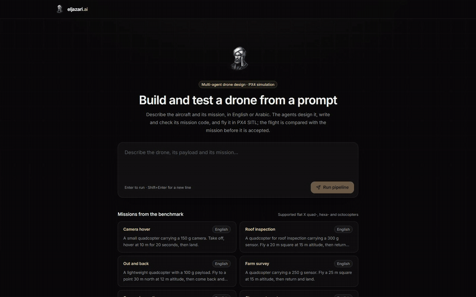
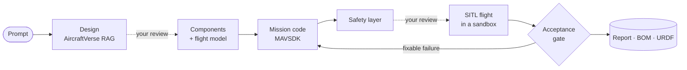

<p align="center">
  
</p>

<h1 align="center">eljazari.ai</h1>

<p align="center">
  <strong>Describe a drone and its mission. Get a design, mission code, and a checked PX4 simulation flight.</strong>
</p>

<p align="center">
  <a href="https://github.com/ezzhamed/eljazari.ai/actions/workflows/ci.yml"></a>
  <a href="LICENSE"></a>
  <a href="https://python.org/"></a>
  <a href="https://nodejs.org/"></a>
  <a href="#status"></a>
</p>

<p align="center"><a href="docs/SETUP.md">Setup guide</a> · <a href="#first-run">First run</a> · <a href="#documentation">Documentation</a></p>

<p align="center">
  
  <br />
  <sub>One real run on the development machine with local models and PX4 SITL; waits are sped up and labelled. <a href="docs/media/demo.mp4">Full-quality video (MP4)</a></sub>
</p>

---

eljazari.ai is an open-source workflow that turns a request such as *"a quadcopter carrying a 300 g sensor, fly a 20 m square at 15 m"*, in English or Arabic, into:

1. a design, and a bill of materials from the component catalogue;
2. a flight model of **that** aircraft;
3. PX4/MAVSDK mission code, checked by a safety layer and approved by you;
4. a flight in PX4 SITL + Gazebo, accepted only if it flew the mission;
5. a report that says what was and was not validated.

**Scope:** "tested" means software-in-the-loop simulation with a flight model estimated from manufacturer data. It is not calibration, hardware testing or airworthiness.

## What works today

| | Capability | Evidence |
|---|---|---|
| **Works** | Component selection that refuses infeasible sets (payload, endurance, voltage, fit) | [Propulsion](docs/PROPULSION_EVIDENCE.md) |
| **Works** | A flight model of the generated flat X quad-, hexa- or octocopter, built from published motor tests; the simulator attests the aircraft it spawned | [Flight model](docs/FLIGHT_MODEL_SITL.md) |
| **Works** | Mission code runs only if identical to the approved version, in a sandbox with no network, secrets or host files | [Sandbox](docs/MISSION_SANDBOX.md) |
| **Works** | A deterministic gate accepts a flight only if it matched its mission: path within 1 m, altitude RMSE ≤ 0.5 m, hold time, landing point | [Acceptance](docs/SIMULATION_ACCEPTANCE.md) |
| **Works** | Durable checkpoints, one run per project across workers, one simulator per host | [Checkpoints](docs/DURABLE_CHECKPOINTS.md) · [Workers](docs/MULTIWORKER.md) |
| Experimental | Benchmark, 48 runs on real SITL (42 scored; 6 ambiguous prompts unscored): supported 20/21, impossible 15/15, unsupported 6/6; Arabic 20/21, English 21/21 | [Benchmark](docs/BENCHMARK.md) |
| Experimental | Injected faults (battery, GPS, link, PX4 killed, motor out) always end in a rejection with a reason | [Faults](docs/SIMULATION_ACCEPTANCE.md#faults-injected-in-sitl) |
| Experimental | Docker simulation runtime; calibration tools (no hardware result yet) | [Flight model](docs/FLIGHT_MODEL_SITL.md) · [Calibration](docs/CALIBRATION.md) |
| Not yet | Independent bench data, calibrated dynamics, HIL, flight on real hardware | |

Sourced flight checks require the optional local manufacturer-data import. A clean clone without it cannot produce an accepted flight.

Only flat X multirotors are supported; tricopters and fixed wings are refused rather than approximated.

## How it works



LLM agents write the design and the code; a LangGraph orchestrator runs the stages and pauses for your approval after the design and after the code. Acceptance is decided by deterministic checks, not by an LLM. Details: [Architecture](docs/architecture.md).

## Quick start

Needs Python 3.11–3.13, Node 22.13+ (or Node 24), npm 10+, Docker and [Ollama](https://ollama.com/), and about 13 GB of downloads ([what and why](docs/SETUP.md#downloads)). Flights also need PX4 and Gazebo, in WSL or Linux ([steps](docs/SETUP.md#px4-and-gazebo)) or in the Docker simulation image.

| Host | Design, code and web app | Run generated mission code | PX4 SITL flight |
|---|---|---|---|
| Linux (Ubuntu 24.04) | Yes | Yes, in the [sandbox](docs/MISSION_SANDBOX.md) (needs unprivileged user namespaces) | Yes: native PX4 or the Docker simulation image |
| Windows 11 | Yes | Yes, inside WSL2 | Yes, in WSL2 |
| macOS | Yes | No: the sandbox needs Linux, so generated code is refused | Untested; the Docker simulation image expects Linux host networking |

The three Ollama models take about 10 GB on disk and run on CPU; a GPU only makes them faster. The development machine's run times are in the [setup guide](docs/SETUP.md#timings).

```bash
git clone https://github.com/ezzhamed/eljazari.ai.git && cd eljazari.ai
cp .env.example .env
docker compose -f infrastructure/docker-compose.dev.yml up -d postgres redis
```

Run `ollama serve` in a separate terminal and leave it running. From the repository root:

```bash
# Backend
cd apps/api
python -m venv .venv && source .venv/bin/activate     # Windows: .venv\Scripts\activate
pip install -r requirements.txt
python -m scripts.bootstrap_components       # optional; without it no flight can be accepted (see below)
python -m scripts.prepare_assets --all        # models, embedder, index (asks first)
alembic upgrade head
uvicorn main:socket_app --port 8000
```

```bash
# Frontend — in a new terminal, from the repository root
npm ci --legacy-peer-deps
npm run dev -w @eljazari/web                          # http://localhost:3000
```

`bootstrap_components` downloads the manufacturer's published motor tests and builds a local catalogue under `.local/components`, which Git ignores. It needs internet access to the manufacturer's site, and the data is not redistributed with this repository ([why](docs/LOCAL_COMPONENT_DATA.md)). Without it, design and code generation still work, but the acceptance gate refuses every flight because no motor has measured thrust data.

The [setup guide](docs/SETUP.md) covers each step, the CLI, configuration, ground control, production and troubleshooting.

## First run

1. Open <http://localhost:3000>, pick a mission under **Missions from the benchmark** (for example *Camera hover*) and press **Run pipeline**.
2. The run pauses after the design. Check the aircraft, its weight and its components, then approve it or send feedback.
3. It pauses again after the mission code and the safety review. Approve the code; only this exact code can fly.
4. The simulation flies the generated aircraft in PX4 SITL. The **Simulation** page shows the flight path, and the run ends with the gate's verdict and the **Performance** report.

A first run takes about 5–9 minutes on the development machine, most of it in the language models.

If PX4 and Gazebo are not installed, the run stops at the simulation with demo telemetry (`simulated_fallback`), and the gate always rejects that. That is expected, not a fault: install the simulator ([steps](docs/SETUP.md#px4-and-gazebo)) and check it with `python scripts/doctor.py` from `apps/api`.

To run without the web stack:

```bash
python cli.py --prompt "A small quadcopter carrying a 150 g camera. Take off, hover at 10 m for 20 seconds, then land." --auto-approve
```

## Documentation

| Topic | Documents |
|---|---|
| Use and operate | [Setup guide](docs/SETUP.md) · [WSL setup](docs/WSL_API_SETUP.md) · [Troubleshooting](docs/troubleshooting.md) · [Clean-clone reproduction](docs/REPRODUCTION.md) |
| How it is built | [Architecture and API](docs/architecture.md) · [Research foundation](docs/research.md) · [Dataset](data/aircraftverse/README.md) |
| Evidence and limits | [Flight model](docs/FLIGHT_MODEL_SITL.md) · [Acceptance gate](docs/SIMULATION_ACCEPTANCE.md) · [Mission sandbox](docs/MISSION_SANDBOX.md) · [Propulsion data](docs/PROPULSION_EVIDENCE.md) · [Benchmark](docs/BENCHMARK.md) · [Calibration](docs/CALIBRATION.md) |
| Project | [Development history](docs/history/README.md) · [Phase map](docs/phases.md) · [Release gate](docs/RELEASE_GATE.md) · [Changelog](CHANGELOG.md) · [Contributing](CONTRIBUTING.md) · [Security](SECURITY.md) |

## Status

**Alpha** (`0.1.0-alpha.1`). Interfaces, data formats and the API can change between releases without notice. See the [changelog](CHANGELOG.md).

This is a reference implementation, not a drone-engineering product. It does not replace eCalc, CAD, Mission Planner or hardware-in-the-loop testing for an aircraft you would fly. Known limitations are listed in the [setup guide](docs/SETUP.md#known-limitations).

## Contributing and security

Contributions are welcome: see [CONTRIBUTING.md](CONTRIBUTING.md) and the [Code of Conduct](CODE_OF_CONDUCT.md). Report vulnerabilities privately as described in [SECURITY.md](SECURITY.md). Note that `POST /api/auth/token` is a development helper, not authentication.

## License and citation

Code: [MIT](LICENSE). The bundled AircraftVerse design data is **CC-BY-4.0**, not MIT ([details](data/aircraftverse/DATASET_LICENSE.md)). T-MOTOR extracts and derived propulsion tables are **not included** in the public distribution. Import them locally for flight checks using the [component-data guide](docs/LOCAL_COMPONENT_DATA.md).

Cite this project with [CITATION.cff](CITATION.cff) (GitHub's **Cite this repository** button), or:

```bibtex
@software{hamed2026eljazari,
  author  = {Hamed, Ezzaldin},
  title   = {eljazari.ai: a multi-agent system for drone design, code generation and simulated flight test},
  year    = {2026},
  version = {0.1.0-alpha.1},
  url     = {https://github.com/ezzhamed/eljazari.ai},
  license = {MIT}
}
```

Cite the design corpus separately:

```bibtex
@inproceedings{aircraftverse2023,
  author    = {Cobb, Adam D. and Roy, Anirban and Elenius, Daniel and Heim, F. Michael and Swenson, Brian and Whittington, Sydney and Walker, James D. and Bapty, Theodore and Hite, Joseph and Ramani, Karthik and McComb, Christopher and Jha, Susmit},
  title     = {AircraftVerse: A Large-Scale Multimodal Dataset of Aerial Vehicle Designs},
  booktitle = {Advances in Neural Information Processing Systems (NeurIPS) Datasets and Benchmarks},
  year      = {2023},
  doi       = {10.5281/zenodo.6525446}
}
```

Named for [Ismail al-Jazari](https://en.wikipedia.org/wiki/Ismail_al-Jazari) (1136–1206), whose *Book of Knowledge of Ingenious Mechanical Devices* described machines precisely enough to be rebuilt from the text. Built on [PX4](https://px4.io/), [Gazebo](https://gazebosim.org/), [MAVSDK](https://mavsdk.mavlink.io/), [LangGraph](https://langchain-ai.github.io/langgraph/) and [AircraftVerse](https://zenodo.org/records/6525446).
